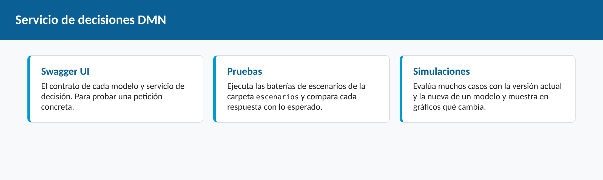
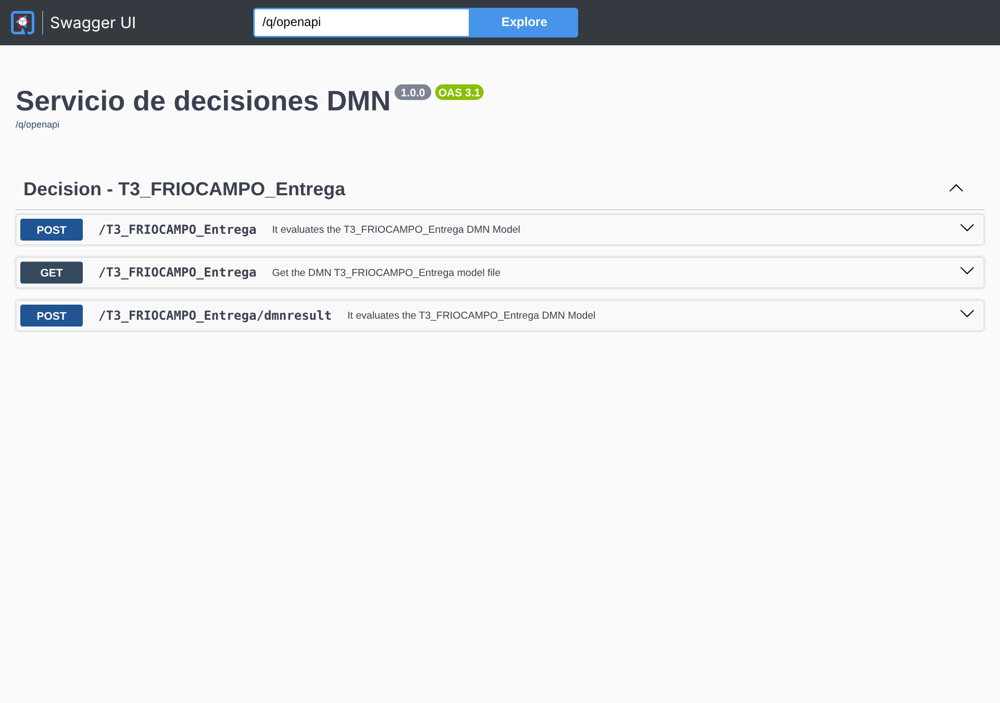
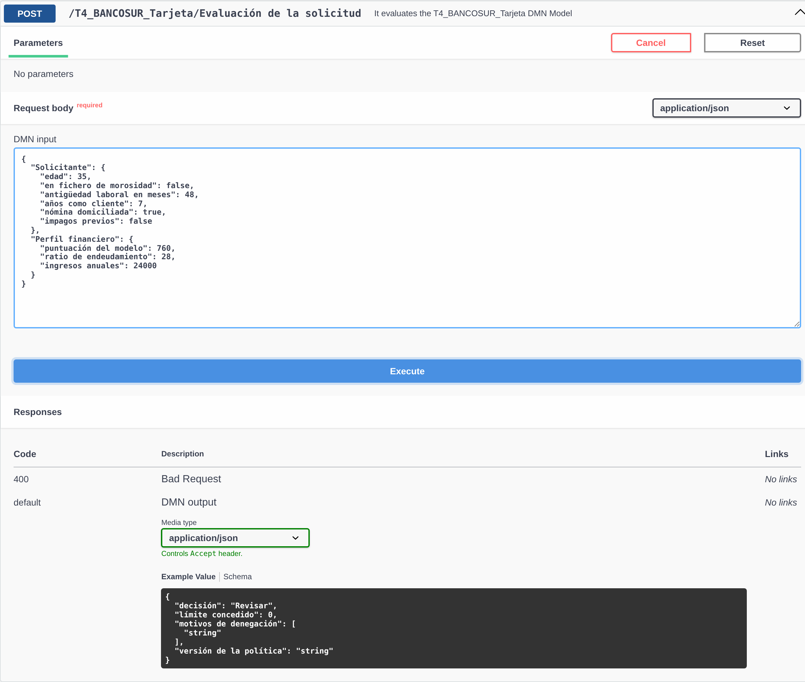
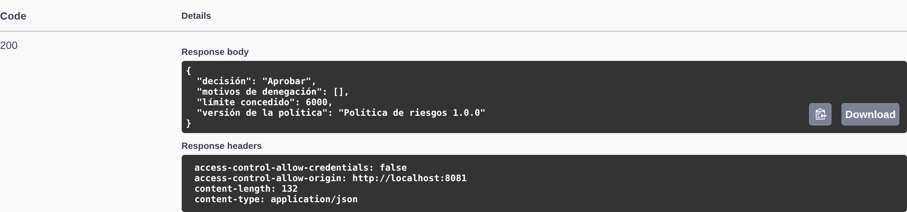
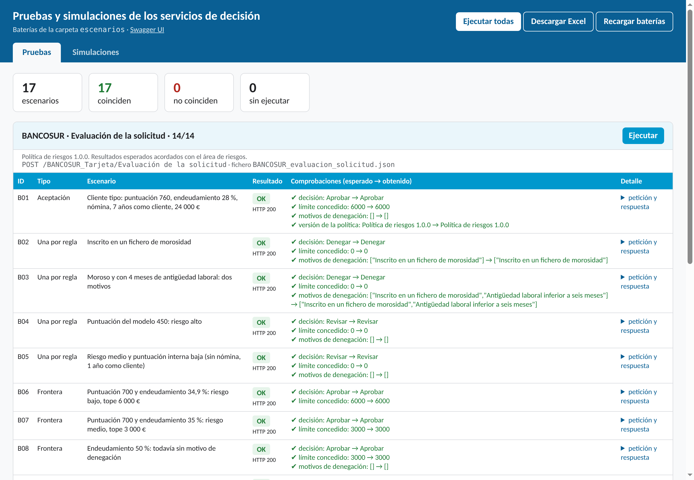
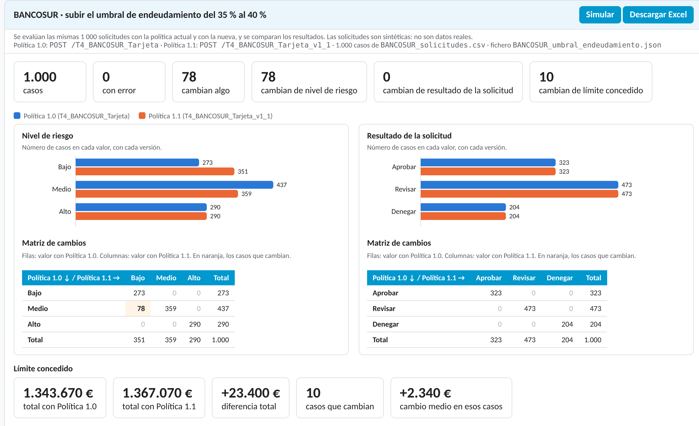

# Servicio de decisiones DMN

Entorno para publicar vuestros modelos DMN como **servicios de decisión** y llamarlos vía API (REST/JSON), sin instalar nada en vuestro ordenador. Usa el motor abierto **Apache KIE**, el mismo que hay debajo de Aletyx Playground: el modelo que diseñáis allí funciona aquí tal cual.

*Sistemas de Ayuda a la Decisión en la Automatización de Procesos · UNIR*

---

## Qué necesitáis

- Un navegador (Chrome, Edge o Firefox).
- Una cuenta gratuita de GitHub: <https://github.com/signup>.

GitHub da a cada cuenta gratuita una cuota mensual de horas de Codespaces; con parar el entorno al terminar (paso 8) os sobra para toda la asignatura.

---

## Paso a paso

### 1. Cread vuestra copia del entorno

En la página de este repositorio pulsad **Use this template → Open in a codespace**.

Se crea vuestra propia copia y se abre en el navegador un editor parecido a Visual Studio Code.

### 2. Esperad a que se prepare

La **primera vez** tarda unos 2–3 minutos: instala Java, descarga el motor y compila el ejemplo. Veréis el progreso en el terminal de la parte inferior. Las siguientes veces se abre en segundos.

Cuando el servicio está listo, el terminal muestra una línea como esta:

```
Listening on: http://0.0.0.0:8080
```

### 3. Abrid el servicio

Al arrancar aparece un aviso abajo a la derecha: **«Your application running on port 8080 is available»**. Pulsad **Open in Browser**. Se abre una pestaña nueva con dos accesos:

- **Swagger UI**, la página que documenta y permite probar vuestros servicios uno a uno (pasos 4 y 5).
- **Pruebas**, que ejecuta de golpe vuestras baterías de escenarios (paso 6).

Si el aviso no aparece o lo cerrasteis: pestaña **PORTS** (Puertos) del panel inferior → puerto **8080** → icono del globo (*Open in Browser*).



En Swagger UI, por cada modelo veréis estas operaciones:

| Operación | Para qué sirve |
|---|---|
| `POST /<modelo>` | Evalúa el modelo y devuelve las entradas y todas las decisiones |
| `POST /<modelo>/dmnresult` | Igual, en detalle: estado de cada decisión y mensajes del motor |
| `GET /<modelo>` | Devuelve el propio fichero DMN |
| `POST /<modelo>/<servicio>` | Solo si el modelo tiene **servicios de decisión**: evalúa ese servicio y devuelve únicamente sus decisiones de salida |
| `POST /<modelo>/<servicio>/dmnresult` | Igual, en detalle |



### 4. Llamad al servicio

1. Desplegad la operación `POST /T4_FRIOCAMPO_Entrega/Planificar entrega`.
2. Pulsad **Try it out**.
3. En *Request body* pegad el contenido de un fichero de la carpeta `peticiones` (por ejemplo, `friocampo_granada.json`).
4. Pulsad **Execute**.



Debajo aparece la respuesta: el **código** (200 si todo ha ido bien) y el **cuerpo** JSON con el resultado: como es un servicio de decisión, solo la decisión de salida, la planificación. Probad la misma petición con `POST /T4_FRIOCAMPO_Entrega` y comparad: el modelo completo devuelve también todas las decisiones intermedias. Swagger muestra además la orden `curl` equivalente, por si queréis repetir la llamada desde un terminal.



### 5. Publicad vuestro propio modelo

1. En Aletyx Playground, descargad vuestro modelo (`.dmn`).
2. En el codespace, arrastrad el fichero a la carpeta **`modelos`** del explorador de la izquierda.
3. Recargad la pestaña de Swagger UI: en unos segundos aparece vuestro modelo con sus operaciones.

Si cambiáis el modelo, basta con sustituir el fichero y volver a llamar al servicio: el motor lo recarga solo.

**Si el modelo tiene un error**, Swagger UI no carga y el navegador muestra una página de error con el mensaje del motor (por ejemplo, *«Decision node 'D' is missing the variable declaration»*). Corregid el modelo en Aletyx, sustituid el fichero y recargad.

> La ruta de cada servicio es el **nombre del modelo** (el que aparece en las propiedades del DMN en Aletyx), no el nombre del fichero.

### 6. Probad con una batería de escenarios

Una **batería** es un fichero `.json` de la carpeta `escenarios` con una lista de escenarios: los datos de entrada y el **resultado esperado**, acordado con negocio. La página **Pruebas** llama al servicio con cada escenario y compara lo que devuelve con lo esperado: verde si coincide, rojo si no.

1. Abrid la página de inicio del servicio y pulsad **Pruebas** (o añadid `/pruebas.html` a la dirección).
2. Pulsad **Ejecutar todas**.
3. Si queréis guardar el resultado, pulsad **Descargar Excel**.



Para crear vuestra batería, copiad `escenarios/FRIOCAMPO_planificar_entrega.json`, cambiadle el nombre y editadlo:

```json
{
  "titulo": "Mi empresa · Mi servicio",
  "modelo": "Nombre_del_modelo",
  "servicio": "Nombre del servicio de decisión",
  "descripcion": "De dónde salen los resultados esperados",
  "escenarios": [
    {
      "id": "E01",
      "tipo": "Frontera",
      "descripcion": "Qué comprueba este escenario",
      "entrada": { "Dato de entrada": 25 },
      "esperado": { "campo de la respuesta": "valor esperado" }
    }
  ]
}
```

- Si el modelo no tiene servicios de decisión, quitad la línea `"servicio"`: se llamará al modelo completo.
- En `esperado` solo hace falta poner los campos que queréis comprobar. Para entrar en un campo de un resultado estructurado se usa el punto: `"Planificación de la entrega.coste"`. Si el servicio devuelve un valor simple (un número, un texto), la clave es `"resultado"`.
- Si esperáis que el servicio responda con un error, añadid `"http": 500` (o el código que corresponda) y, en `esperado`, un trozo del mensaje: `"mensaje": "is not allowed by the declared type"`.
- Pulsad **Recargar baterías** después de guardar el fichero; no hace falta reiniciar el servicio.

Las mismas baterías se pueden lanzar desde el terminal con `python3 pruebas/probar.py`, que genera un informe en la carpeta `informe`.

### 7. Simulad el impacto de un cambio

Una **simulación** evalúa muchos casos con la versión actual de un modelo y con la nueva, y muestra qué cambia: cuántos casos cambian de resultado, en qué sentido y cuánto. La prueba dice si la regla hace lo que se pidió; la simulación dice qué le pasará al negocio.

1. En la página **Pruebas**, abrid la pestaña **Simulaciones**.
2. Pulsad **Simular**. El ejemplo de BANCOSUR evalúa 1 000 solicitudes sintéticas con la política 1.0 y la 1.1.
3. Mirad los gráficos (pasad el ratón por encima de las barras), la **matriz de cambios** y la lista de casos que cambian. **Descargar Excel** guarda el resumen y todos los casos.



Para crear vuestra simulación necesitáis las dos versiones del modelo en `modelos`, cada una con su propio nombre de modelo, y dos ficheros en la carpeta `simulaciones`:

- Un **CSV con los casos** (se puede preparar en Excel y guardar como CSV): una columna por dato de entrada, con el mismo nombre que en el modelo, y una columna `id`.
- Un **fichero `.json`** que dice qué comparar. Copiad `simulaciones/BANCOSUR_umbral_endeudamiento.json` y cambiad:

```json
{
  "titulo": "Mi empresa · Qué cambio simulo",
  "actual": { "modelo": "Modelo_v1", "etiqueta": "Versión actual" },
  "nueva":  { "modelo": "Modelo_v2", "etiqueta": "Versión nueva" },
  "casos": "mis_casos.csv",
  "comparar": [
    { "campo": "Resultado", "tipo": "categoria", "orden": ["Aprobar", "Revisar", "Denegar"] },
    { "campo": "Importe", "tipo": "numero", "unidad": "€" }
  ],
  "mostrar": ["Dato de entrada que queréis ver en la lista"]
}
```

- `categoria` dibuja un gráfico de barras y una matriz de cambios; `numero` muestra el total con cada versión y la diferencia.
- Si queréis llamar a un servicio de decisión en lugar del modelo completo, añadid `"servicio": "Nombre del servicio"` dentro de `actual` y de `nueva`.
- Pulsad **Recargar simulaciones** después de guardar los ficheros.

### 8. Parad el entorno al terminar

Id a <https://github.com/codespaces>, pulsad los tres puntos junto a vuestro codespace y elegid **Stop codespace**. Si se os olvida, se para solo tras 30 minutos sin uso. Vuestros ficheros se conservan; para volver, abrid el codespace desde esa misma página.

Para guardar los modelos en vuestro repositorio de GitHub: icono de **Source Control** (barra izquierda) → escribid un mensaje → **Commit** → **Sync**.

---

## Preguntas frecuentes

**La respuesta da código 500.** El servicio ha recibido la petición, pero no ha podido decidir: o algún dato no cumple el contrato (un valor que no está entre los permitidos, un texto donde va un número), o alguna decisión ha fallado. El entorno trabaja en **modo estricto**: comprueba los tipos de los datos de entrada y rechaza los que no encajan, en lugar de seguir con un null. Repetid la llamada con la operación `/dmnresult`: el campo `messages` dice qué decisión falló y por qué, y `decisionResults` muestra el estado de cada una (`SUCCEEDED`, `FAILED` o `SKIPPED`).

**La respuesta da código 400.** El JSON está mal formado (falta una llave, una coma o unas comillas). Revisadlo o pegad de nuevo un ejemplo de `peticiones`.

**¿Puede llamar a mi servicio otra persona o un proceso externo?** Por defecto el servicio solo es accesible para vosotros. Si una actividad lo pide: pestaña **PORTS** → clic derecho en el puerto 8080 → **Port Visibility → Public**. Volved a ponerlo en privado al terminar.

**Prefiero trabajar en mi ordenador.** Seguid la guía [GUIA_WINDOWS.md](GUIA_WINDOWS.md).

---

## Contenido del repositorio

| Carpeta o fichero | Qué contiene |
|---|---|
| `modelos/` | Los modelos DMN que se publican (atajo a `src/main/resources/modelos`): FRIOCAMPO y las dos versiones de la política de BANCOSUR |
| `peticiones/` | Peticiones JSON de ejemplo para el modelo de FRIOCAMPO |
| `escenarios/` | Baterías de escenarios que ejecuta la página Pruebas |
| `simulaciones/` | Simulaciones (configuración y casos en CSV) que ejecuta la pestaña Simulaciones |
| `pruebas/probar.py` | Las mismas pruebas desde el terminal, con informe HTML y Excel |
| `arrancar.cmd` / `arrancar.sh` | Arranque en un ordenador propio (Windows / Mac o Linux) |
| `pom.xml`, `mvnw`, `.devcontainer/` | Configuración del entorno; no hace falta tocarlos |
